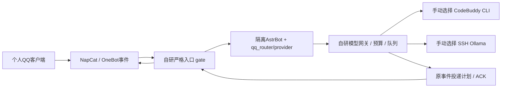

# LAP-38：识图、网页理解与个人微信接入规划

返回[交接](HANDOFF.md) / [PROGRESS](../../../../PROGRESS.md) / [TASKS](../../TASKS.md)。2026-10-22，Asia/Shanghai；仅规划，未实施/部署。本轮用户指定sol/max；会话设置由用户选择，不声称自动检测或切换。

## 1. 用户需求与这次结论

1. QQ端至少做好当前消息图片理解；网页理解效果需要改善。如果真实证据证明所选上游不能提供必要材料，可以明确列为不支持，不无限补丁或换付费服务。
2. 在 `E:\CodexWS\WeChatbot` 开发独立微信版本，用于个人娱乐、朋友家人聊天。调研现存消息接入框架，尽量复用已有模型/安全/预算能力。
3. 给后续gpt-6.1-sol/medium留下可直接执行的分阶段指令。

结论：**QQ图片没有“NapCat拿不到图”的证据；当前识图配置关闭、所选CLI组合未获视觉授信，真实入站也未验。网页已复现正文质量问题，当前网络又有成功真实读取证据，应先修提取和相关段落选择。微信可以沿用分层思想，但不能只把NapCat换个名字：事件身份、@、去重、图片和发送结果都须适配。**

微信选型分两层：对本用户“亲友普通聊天”先以 `Hello-Mr-Crab/pywechat` 中的 `pyweixin` 做4.1系列桌面接入可行性验证；它目前不是已满足QQ合同的生产后端。腾讯iLink作为官方个人Bot接口研究/可选私聊路线，当前源码只声明direct，不能交付普通亲友群功能。旧WeChatFerry结构最接近消息协议层，但已归档且依赖旧客户端；Gewechat已停维护，不作为新项目基线。来源/限制见[微信调研](wechat-bootstrap/docs/RESEARCH.md)。

## 2. 当前链路与可复用范围

用户的“QQ→NapCat→自研→LLM”大方向正确；自研部分还包括AstrBot插件、访问控制、模型工具隔离、历史、清理台账和发送确认。入站图片和出站表情是两条能力；能发表情不等于能理解收到的图片。

微信首期采用独立适配器和轻量路由器，复用固定QQ源码快照中的模型runner/预算/清理组件，不在QQ运行实例加第二平台，不伪造QQ号/OneBot账号，不先做一次横跨两项目的核心重构。微信不必为了调用LLM再安装完整OpenClaw或再套一个完整聊天框架。具体目录/协议/隔离见[微信计划](wechat-bootstrap/docs/PLAN.md)。

## 3. 证据等级与现状

详见[本轮只读证据](EVIDENCE.md)。以下不把源码推断当真实通过。

| 能力 | 当前证据 | 尚缺什么 |
| --- | --- | --- |
| QQ image段/URL映射 | 本机NapCat源码有图片URL生成；28A/C代码及历史离线通过 | 一次真实准入事件→有界bytes→像素解码 |
| QQ原生识图 | 本机保存 `vision.enabled=false`；当前 `codebuddy_cli/deepseek-v4.1-flash`；审阅表records为空 | 所选模型视觉声明、实际处理路径/容量、六例原生质量及群ACK |
| 公共网络 | 本轮六域均有公网解析；现有PublicHTTP取得3份公共正文；Bing RSS三查询可解析 | 重复比较时另一次连接超时；稳定性、真实搜索相关性和模型回答未验 |
| 网页正文 | JSON官方文档一次现有提取仅3726字符，三个关键标识均未进入材料 | 正文结构优先、问题相关选材、真实事实保留验收 |
| B站 | 06轻量单轨字幕代码/离线已交付 | 真实字幕/认证/回答/ACK；07 ASR及完整视频仍缺 |
| 微信 | GitHub源码/维护状态核对；目标目录初始为空 | 本机客户端/UI能力、稳定身份/@/ACK/图像材料；0真实微信验证 |

普通日志主动抑制原包和大部分WEB信息；零图片/WEB日志只能表示无可见记录。当前用户运行实例未由本轮探活/启停，不能沿用37“当时停机”推断现在仍停机，也不能把保存的YAML当作进程已加载配置。

## 4. 优先级、任务和依赖

| 顺序 | 后续领取 | 范围与完成出口 |
| --- | --- | --- |
| 1 | LAP-18续作C | 修已复现正文丢失、相关选材和封闭诊断；离线及受影响实际框架通过。真实公共材料可单独批次核验，不调用模型 |
| 2 | LAP-28续作R | 按[QQ合同](QQ_VISION_WEB_PLAN.md)补实际Windows/GGUF路径探针、边界计算和可验证激活工件；只代码/离线，不自动SSH/换后端/开图 |
| 3 | LAP-28真实A→R→IQ→Q批次 | 先0模型一张自造图入站；再明确家庭只读范围；再所选后端六例、最后真实群同链，逐批执行、不把本计划当授权 |
| 独立 | 微信WX-01 | 目标目录只做离线骨架、规范事件/投递/模型复用，mock适配，默认所有实际通道关闭 |
| 独立 | 微信WX-02 | pyweixin源码封装和能力探针；默认inspect/mock，真实UI观察需后续明确对象/窗口/样本；能力不足交付缺口报告 |
| 条件 | 微信WX-03/04 | WX-02满足身份/@/去重/投递门槛后做实际适配，再按明确小批次验收；不能凭上游函数存在跳过门槛 |

以上是依赖顺序，不是授权自动串行执行整表。一个session只领取一个任务。微信离线工作可不等待QQ识图，但不能把QQ视觉/公网的历史状态直接授信给微信。LAP-06旧真实差额继续保留，本轮不新开ASR、成员或群记忆功能。

## 5. 不做的事

- 不修改运行配置、人设、凭据/CA/代理/DNS，不启停bot、不登录、不发群/私聊、不调用真实模型、不SSH。
- 不自动换模型、账号、额度来源、视觉专用后端或付费API；CodeBuddy与家庭Ollama继续由操作者显式选择。
- 不用OCR替代整个识图目标，不加浏览器抓取、无字幕ASR、多轮材料分类、无新消息定时主动发言。
- 不读取日常微信数据库、密钥、密码/历史聊天；不自动降级或覆盖日常微信，不为了UI自动化修改系统防睡眠/键鼠/全局配置。
- 不删除unknown/cleanup记录，不把本轮文档Git交付当上线。

## 6. 文件与交付边界

本轮：本目录HANDOFF/PLAN/QQ_VISION_WEB_PLAN/EVIDENCE/IMPLEMENTATION_GUIDE及`wechat-bootstrap`纯文档，三个QQ索引及18/28/36交接的最新指针。`wechat-bootstrap`作为版本化文档快照，逐文件核验复制到目标微信目录，目标不导入QQ状态或秘密。不创建远端仓库、不臆造GitHub地址；QQ内快照随长期授权commit/push，微信目标目录文档副本未独立推送要明确说明。

QQ后续源码/配置字段/默认值/预算/验收/回滚详见[QQ合同](QQ_VISION_WEB_PLAN.md)；微信详见[独立计划](wechat-bootstrap/docs/PLAN.md)、[调研](wechat-bootstrap/docs/RESEARCH.md)和[目标入口](wechat-bootstrap/PROGRESS.md)。最终复制指令见[medium指引](IMPLEMENTATION_GUIDE.md)。

## 7. 兼容、回滚及未知分支

本轮纯文档不改变运行行为。旧36方案被本轮**补充**：28A/18B/28C/06D已有实现不重做；当前公网不再定性为永久blocked；新增网页提取质量修复，补28R此前实际路径缺口和微信独立路线。全部旧验收差额继续保留。

后续QQ升级先保留现有配置键/默认关闭视觉及单次尝试、入口授权/黑名单/私聊关闭/哑巴代际/原事件ACK；新选择策略默认保持coverage，操作者显式选question后下次正常启动生效。回滚先正常停机，关闭新策略/vision、恢复配对代码和配置，保留历史、投递及未知台账。

微信初始空状态、无自动运行，不迁移QQ账号/授权群/黑名单或私密资料。每项能力分别记 `unverified / source_supported / offline_passed / observed / accepted`，最终可用从证据派生。若所选上游确认不能提供像素、可信身份或正常消息收发，只关闭对应能力/通道并记录版本、失败阶段和可重查条件；其余独立工作照常交付。涉及新付费服务、客户端降级/换设备、不同模型或降低身份边界时回sol/max，不由medium自行改变方案。
