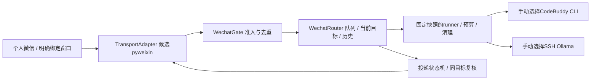

# WeChatbot独立项目详细实施计划

返回[PROGRESS](../PROGRESS.md) / [TASKS](../TASKS.md) / [源码调研](RESEARCH.md) / [medium指引](IMPLEMENTATION_GUIDE.md)。2026-10-22，Asia/Shanghai；仅规划。目标目录 `E:\CodexWS\WeChatbot` 初始为空，本轮仅建立文档。

## 1. 需求、假设与非目标

用户个人用着玩、朋友家人聊天。目标是微信也能提供类似QQ的人设文本交流，并在已有识图路线可用后理解当前图片。以普通个人微信群聊为主要候选场景；亲友私聊作为微信端独立的**显式白名单选项**，默认关闭。这是规划边界，不是当前已授权收发范围。

首期只做一个账号/一个明确授权会话的小规模验证，逐步验收后才增加名单；不读取全部联系人或历史来发现目标。先mentions，free在真实@/身份/投递成立后另行启用。默认无定时主动发言。角色正文独立维护，不能让人设扩大接入权限。

不做公众号/企业微信替代、不装完整OpenClaw、不购买微信协议/LLM API、不自动降级/重装/退出日常微信、不访问本机微信数据库/解密密钥、不自动加好友/拉群/转发/朋友圈/红包/电话/语音/任意出站文件。QQ运行方式与配置不改变。

**未知能力是项目风险而非已经判定不可行：** 当前pyweixin源码使用群友显示名与UI runtime_id，尚不能满足可信身份/去重/@合同。WX-02是明确的能力验证任务；若缺口被确认，不强行部署自动聊天。iLink只作可选私聊路线，不默认替换亲友群目标。

## 2. 分层架构与技术选择

采用Python3.12、独立虚拟环境。WX-01不安装pyweixin；只mock。微信适配放 `src/wechatbot/transports/`，业务不直接依赖第三方UI对象、联系人名字或上游AutoReply。首期直接调用固定模型runner库，不复用QQ的AstrBot实例/qq_router，不伪造数字QQ身份塞进OneBot；避免让框架自己的默认自动回复/工具/历史抢先触发。

复用方式：从已审阅QQ基线commit `dd9373029412137023124751d75883824122c784` 导出**已跟踪的**`src/qqbot_gateway/`固定源码包和必要公开CLI能力/锁文件，到新项目同层`src/qqbot_gateway/`及config公开文件。记录逐文件sha256、源commit和本地改动于 `vendor/qq-core-manifest.json`。这是独立快照，不是editable指向QQ、不软链、不运行git clone复制秘密、不直接依赖QQ的8765服务。

WX-01先证明text路径调用链可在新root正确加载：create_runner/InputBudget/文本过滤/独立CleanupOwner及所需配置。新 `wechatbot/config.py`只把必要LLM/chat/output字段映射给runner，不运行要求QQ数字身份的旧config/gate/main。保留包目录使旧ROOT定位仍指新项目；凡硬编码旧入口/端口/真实身份接点必须隔离或拒绝，不能顺手重构QQ源仓库。CLI工具拒绝/固定MCP配置/清理未知阻断照搬语义，新增root相关测试。

初期不启用其他QQ功能，因而不要求在WX-01复刻完整free关注、群记忆、成员@、表情、网页/B站或视觉服务。后续微信网页/视觉可复用经审阅模块，但需自己的传输/入口、最终预算和绑定证据；不能抄QQ的active或IQ台账当已通过。

## 3. 传输接口与行为合同

### 3.1 NormalizedEvent v1

适配器只返回封闭对象，拒未知字段/超限/重复JSON键，最大64KiB/一批32条；标识为1—256字符不透明字符串，文本≤4000字符，拒控制字符/路径解释。schema字段：

| 字段 | 合同 |
| --- | --- |
| version/platform/transport | 固定1/wechat及已登记transport枚举 |
| account_id/conversation_kind/conversation_id/sender_id | 传输可信稳定标识；kind=group/direct；显示名单独作可选展示，不作主键 |
| source_message_id/id_scope | 原传输消息ID；id_scope=server_stable或process_local；生产默认要求server_stable |
| received_seq/received_monotonic/adapter_epoch | 自研单进程单调序列/接收时间/本次连接代际，不冒充源站时间或服务端ID |
| sender_is_self/mention_self | 信任来源的布尔事实；mention_self缺失视为unknown，不从正文补成true |
| text / first_image_handle | 纯文本与可选的一次RAM材料句柄；不带URL/本机路径/base64/原XML进模型 |
| capabilities_digest | 绑定所选账号/客户端版本/适配器代码/能力观察，不是任意caller填写passed |

不能把昵称hash当sender_id、群名hash当群ID、正文hash当跨重启消息ID；duplicate消息即使文本相同也应按真实来源ID分别处理。process_local仅允许离线/观察，不给生产发送资格。已采集raw事件属于传输底层，不记录其正文/私密标识。

### 3.2 入口与触发

依次验证：传输/所选账号→最小可信身份/类型→黑名单→授权会话/私聊开关→自身回环/系统/重复/代际/大小→RAM窗口/材料→模型。未通过时0模型/0图片下载/0新增历史；UI底层仍可能收到事件，这与QQ底层收包和项目过滤的区分一致。

授权群模式mentions：只有真实mention_self=true的新消息回应；普通“@名字”、引用旧@、自发回环、全体@默认不触发。当前传输没有可信@则该群路径保持mention_unverified，不改成关键字/全回复。

显式白名单私聊：direct.enabled=true且sender/conversation均受操作者可信绑定才回应，不需要@；新事件与每用户会话隔离，不能把owner私聊内容带进亲友群。非名单私聊完全丢弃。黑名单优先于所有白名单。

free不是首期默认；后续能力齐备且操作者选择free时才由新消息触发一次说/不说，真实@绕过自发沉默/冷却；无新消息不运行模型。群停言/代际栅栏先按QQ35语义实现本地识别：明确停言无确认消息，同条停言优先，后续新真实@恢复，连接重连保持、owner重启复位。若真实@未知则不启用需要它的群生产路径。

### 3.3 发送与历史

每次调用TransportAdapter.send_text前重新验证账号/会话/发送资格/黑名单/代际/当前任务冻结目标；adapter不得按文本搜索找“最像的群”。UI窗口身份或焦点变化就取消提交。每气泡最多一次，默认单气泡纯文本≤8000字符，不带自动@/引用，不调用上游AutoReply。

投递状态为prepared→submitted→accepted/failed/unknown；pending状态先持久落盘。`api_accepted`、`ui_observed`、`none`是不同ack_level：API ret=0只能表示API接受；UI按键返回不能算accepted。生产群默认要求可关联本次消息的可靠接受结果，source级别尚未实现则delivery_unverified。

UI只看见一个新气泡且文本相同可能与手工消息冲突；必须有明确任务/提交边界/同窗口观察和无歧义证据，未证明时unknown，不提交assistant历史、不自动补发。重启只恢复未决状态，不重放旧群消息或已提交模型请求；unknown阻断对应目标，模型清理unknown按所选runner合同阻断。成功入历史要求确定的投递级别，不能用sleep后无异常冒充ACK。

持久状态只保存投递/去重/必要有限会话历史，全部忽略；不能为了去重导入旧聊天。显示名改动、同名群/用户、换账号/重连后UI元素重建、突发多条、自己手工发送、窗口切换、取消、部分输出和崩溃都是必测负例。

### 3.4 图片边界

WX-01默认不取图。WX-02只报告图片事件存在与像素可得性分开；不可用时不能读截图文字占位后声称识图。真实取图测试仅一条操作者自造图，精确绑定当前消息/会话/发送者、最多第一张/一次材料兑换；8MiB原件、1024边/100万像素RGB PNG、512KiB规范化、2MiB wire、60秒TTL、取消释放。不能通过“最后N张媒体”或引用/历史补拉绑定。

若上游只能保存到文件，须后续明确授权项目专属临时目录，固定路径/真实文件类型/非链接/有界读/完成删除；不能传任意微信日常路径或让模型读文件。若无法按当前消息得到可信像素，images=unsupported，本项目仍可交付已验证文本。

模型实际视觉门槛继承QQ28R的源码审阅/运行工件/最终容量/IQ，而微信需要自己的入口与最终binding；QQ允许域URL下载策略不能原封不动放开微信任意CDN。新增网络媒体传输须固定用途/来源/TLS/peer审阅，不为图片下载使用全局代理或任意URL工具。

## 4. 配置与默认值

计划五份中文逐参数注释YAML，与独立persona.md及README索引。公开模板在config/examples，本机config/local和secrets、state、runtime、logs、cache全部忽略。无实值占位身份，不读取QQ local来自动初始化。

| 文件/字段 | 默认与合同 |
| --- | --- |
| bot.yaml：platform / enabled | wechat / false；只有明确启用才尝试真实通道 |
| bot.yaml：transport | mock；首个已规划候选值pyweixin；ilink不在首期可启用枚举 |
| bot.yaml：account_binding_file | secrets/wechat-account.local.json；没有可信绑定则拒绝；不放密码 |
| bot.yaml：allowed_groups / blocked_users | 均空列表；稳定ID，不接受昵称代替 |
| chat.yaml：direct.enabled / allowed_users | false / []；微信独立开关，不修改QQ私聊关闭 |
| chat.yaml：participation.mode | mentions；free须群能力通过后显式选择 |
| chat.yaml：silence.enabled / history_turns | true / 8；群与私聊历史键隔离，有限历史只在本项目 |
| chat.yaml：output.delivery_mode | single；adaptive暂不作为第一版接受项 |
| models.yaml：llm.backend | codebuddy_cli；默认deepseek-v4.1-flash，effort=auto、原生窗口null |
| models.yaml：ollama_ssh profile | 已知qwen3.5:9b-q4_K_M模板，num_ctx=16384/think=false/num_predict=1024；digest/连接为空，未授权不读QQ资料 |
| models.yaml：max_concurrency / queue_limit | 1 / 5；独立队列/清理台账，不承诺双项目总额度或自动余额切换 |
| features.yaml：web/vision/memes/memory/members/bilibili | 均enabled=false；只先实现所需关闭兼容，不复制QQ启用状态 |
| runtime.yaml：host / health_port | 127.0.0.1 / 8875；只本机只读元数据；绑定前检查端口占用，冲突拒启不自动换端口 |
| runtime.yaml：ui_observation.enabled / sends_enabled | false / false；本地inspect不接触UI/模型，代码中能力门槛另行派生 |
| runtime.yaml：raw_message_logging / auto_start | 固定false / false；不注册Startup/计划任务 |

保存后下次正常手动启动读取单一配置快照/摘要；启用与能力证明分别校验，enabled=true不能绕过未验门槛。字段unknown/错误值拒绝。配置检查0模型、0登录、0发送；状态输出只显示分层ready，不回显账号/群/私密路径。新项目不继承QQ版本化persona正文，模板用中性简短说明，用户以后自行选择内容。

## 5. 任务顺序与文件归属

| 任务 | 本次状态 | 后续可写文件/完成出口 |
| --- | --- | --- |
| WX-00 | 详细规划完成，未实施 | PROGRESS/TASKS/AGENTS、docs三份、tracks/bootstrap/HANDOFF；无runtime |
| WX-01 | 待用户实施指令 | pyproject/锁、src/wechatbot的config/contracts/capabilities/gate/router/delivery/store/model_facade、mock、固定src/qqbot_gateway快照/manifest与必要公开config、tests、README/操作骨架及任务交接；离线从入站到mock ACK闭环 |
| WX-02 | 待指令，依赖01 | transports/pyweixin_adapter.py、能力/窗口绑定探针、固定第三方锁与来源/许可、mock/默认inspect测试、报告；真实UI阶段另批，0模型/0发送默认 |
| WX-03 | 条件待领取 | 已证明的transport能力接入严格gate/投递/当前图接口及回归；门槛未过只报告，不实现昵称旁路 |
| WX-04 | 条件待领取 | 真实小批次文本/必要图片、同目标投递/隔离/重启接受报告及本机明确启用；不先做24h/开机自启 |

实施首次领取相应任务后再建tracks/tasks/WX-xx/HANDOFF，登记PROGRESS/TASKS并写后重读；不提前为所有未领任务造空HANDOFF。每session只做所领一项；WX-02失败不自动改iLink/Hook或WX-03。

## 6. 验证与接受

WX-01的测试必须验证真实业务状态机而非assert实现细节：未授权/黑名单/私聊关闭在窗口/模型/图片/历史前拒绝；可信@和普通@文本区别；身份/会话/代际变化；稳定ID去重和相同文字不同消息；并发取消/unknown/部分发送；纯文本过滤/工具隔离；配置在新root不会读QQ私密文件；无图时固定runner底层替身完成从gate→预算→一次调用→原任务ACK→历史。实际模型、微信、家庭SSH均0。

WX-02默认inspect/mock只静态检查已锁源码/文件版本与mock能力，不导入有副作用的上游初始化。真实观察需要后续指定账号/已由操作者打开的单会话窗口、最多10条自造事件/120秒、0发送/0模型；仅读取允许UI属性，不遍历全部联系人/历史、不截图保存真实聊天、不点击系统设置。必须区分实际稳定ID、display_name、runtime_id；检查无UI树/同名/改名/重建/真实@与普通@、单图绑定和已知不可用分支。观察时限不等于长稳证明。

WX-04以后明确小批次：一个白名单会话、两条正常文本（最多2次模型、每条最多一次发送），一个未授权/黑名单合成反例优先离线验证；私聊与群聊分别验收，没验的一项保持关闭。图像如获独立支持，再走六例原生质量和1条当前图闭环，不能额外隐含试调用。任何取消/失败/unknown消费当次，不自动换trace补跑。

完整接受至少包括：亲友实际能访问目标会话、两个不同发送者隔离、原生文本正确投递、黑名单前置、实际@触发/普通@不触发、断线恢复不重放、unknown不重复、客户端版本/账号/UI身份可复核、明确部署方式与不支持项。UI锁屏/远程断开/24h无人值守不在首期保证；未验证就单列，不让防睡眠设置“修复”它。

## 7. 兼容迁移、Git与回滚

没有QQ数据迁移。源码复用只带已审阅公开代码及必要锁文件，逐文件记录来源；修复两项目采用显式移植/各自验证，不互相覆盖活动工作区。家庭秘密不复制，后续明确授权时在本项目secrets单独建立对应连接文件；已有QQ未知状态不会被微信服务读写或清除。

本规划文档的版本化快照在QQ仓库LAP-38内并按其长期授权交付；目标微信目录是同内容引导副本，尚无独立Git/remote。WX-01后续实施可初始化本地Git并提交可审阅检查点；默认分支codex/bootstrap，用户以后给出远端地址及发布指令再推送，不自行创建公开仓库。

回滚只停有创建身份的微信网关/worker，禁用transport/sends，保留pending/unknown、配置备份和有限历史；不关闭、注销或kill附着的日常微信，不修改QQ进程/端口/全局账户。恢复旧代码须配对配置/manifest；旧版无法识别unknown保持停止。

若WX-02确认只提供昵称/临时ID/按键结果，验收出口是“离线核心完成，当前UI上游不满足生产合同”。下一步回max选择产品形态/传输或明确不同实验边界；不能将这一结果写成微信功能完整失败或凭空承诺别的协议可用。
