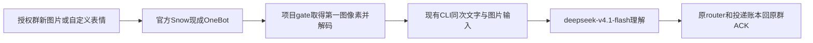

# LAP-42：Snow既有功能整合落地计划

返回[PROGRESS](../../../../PROGRESS.md) / [工作线](../../HANDOFF.md) / [TASKS](../../TASKS.md) / [交接](HANDOFF.md) / [完整medium指令](MEDIUM_START.md)。2026-10-25，Asia/Shanghai，session `LAP-42-snow-feature-rollout-plan`。

## 1. 最新需求与任务关系

用户要求长期群记忆、成员增强、关注增强交medium落地，图片识别也尝试，B站字幕撤下。用户明确**当前deepseek-v4.1-flash支持视觉**；保持当前CodeBuddy/model/low和额度来源，不切换后端，不按媒体自动分流。

42负责既有27/28/29/30在Snow下的组合适配、统一配置激活和06退役，不重写聊天大脑。ID已查空闲；旧26/38未包含这次Snow组合发布与字幕退役，故独立登记。medium只领取42，旧任务历史及未验差额保留，不同时重领四项原实施。

| 功能 | 当前事实 | 本任务出口 |
| --- | --- | --- |
| 长期群记忆30 | 已实现/离线通过，读取/学习false，新根无key/库 | 复用有界持久记忆，开启读取/学习，从新消息开始，不搬旧历史 |
| 关注27 | 已实现/离线通过，attention=false，free已在用 | 开启叫名/引用bot/短时焦点，保留真实@、停言、新消息驱动 |
| 成员29 | 已实现/离线通过，生产硬暂停，缺当前来源适配 | 补Snow只读强刷观察，少于50人时名册候选及最多1个受控@ |
| 图片28 | 像素/原生输入/投递骨架已有，模型视觉支持由用户确认 | 实做QQ取图→当前CLI像素输入→模型理解→原群回复，逐段验收 |
| B站06 | 已关闭，但服务构造/字幕路由/提示仍在 | 撤下运行功能和日常入口，必要旧配置兼容，不再读Cookie/抓字幕 |

分别记录代码完成、离线通过、配置保存、运行加载、真实通过和完整验收。某能力未过不阻止其余独立功能落地，不能将所有功能停在“已规划”。

非目标：重装/重做接入或文字首试；改官方Snow/QQ/CLI或第三方SDK/依赖包内部；改persona正文、账号/模型/额度、free及现有聊天参数；任意媒体/全账号RPC/旧历史；后台主动任务；额外caption/OCR/embedding/summary模型或付费API；A4/B/C复核、资格/proof/probe或长稳。本项目已确认无引用的字幕专用文件可按退役删除，不修改其第三方包实现。

## 2. 当前代码证据与能力分级

起点HEAD/实时远端均`9bb1b58270dbcaa3c5e40c53f804d5e50c54449b`，codex/lap-40-snowluma，Git干净。已读PROGRESS、工作线交接/台账、30/28/27/29交接及原26 SPEC记忆节、38 QQ视觉合同；不泛读历史。

- [group_memory.py](../../../../src/qqbot_gateway/group_memory.py)：DEFAULTS读取/学习false，开启后在本根secrets/group-memory-key.local.json创建/读取HMAC key，state/group-memory存库；prepare/stage/close已覆盖来源、candidate、同轮提议、文字ACK、CAS、TTL/purge，不需新数据库。
- [router](../../../../plugins/qq_router/main.py)：共用v2/原事件投递，attention_effective=false时addressing恢复mention/ambient；只开memory不应偷偷开启叫名。组合开启应验证已有分支，不改写dispatcher。
- [members.py](../../../../src/qqbot_gateway/members.py)：require_production拒所有enabled=true，suspend_unverified总返回false；Members.roster人数查询未加no_cache，observe只由测试注入。[config.py](../../../../src/qqbot_gateway/config.py)还硬编码members_enabled=false，[configure_astrbot](../../../../scripts/configure_astrbot.py)也暂停；只改local无效。
- 官方本机v2.1.1 index.mjs只读：get_group_info注册约8393、实现约32428；no_cache=true先await contacts.fetchGroupList且失败抛出。后者约58671直接await FetchGroupList.invoke网络结果；get_group_member_list约32480的no_cache分支走force，约58713为single-flight缓存。无需改官方包，也不扩建A4证明系统。
- [vision.py](../../../../src/qqbot_gateway/vision.py)：已有第一图取材、真实解码、透明底合成、GIF首帧、1024边/100万像素PNG；cli_message把text和base64 image放同一user内容数组。[CLI runner](../../../../src/qqbot_gateway/workbuddy_cli_runner.py)已有输入下发和预算检查，须验证实际传输与同次返回。
- [vision_capabilities.py](../../../../src/qqbot_gateway/vision_capabilities.py)及[视觉表](../../../../config/vision-capabilities.json)：records目前为空。旧视觉声明缺失是历史快照，用户现在确认模型支持；实际CLI输入/预算/质量仍单列，不将托管模型套成必须观测家庭GGUF本地processor/projector路径。
- scripts/manage.py:intake_only目前固定启动NapCat；不能直接执行旧真实intake。Snow采样仅在项目管理/观察层适配。
- [web_retrieval.py](../../../../src/qqbot_gateway/web_retrieval.py)、[persona.py](../../../../src/qqbot_gateway/persona.py)、loader等仍有B站引用；退役须清运行接点，同时保留普通网页和搜索质量门槛。

当前磁盘：free、web/memes=true；attention/vision/members/memory/learning/bilibili=false，记忆key/目录不存在。21的active catalog不存在、pending存在，7图数据准备已交付；42不动pending、不复做图库。未查询当前在线，未读原始消息/真实记忆/秘密值。

## 3. 记忆与关注的行为合同

记忆只在本bot/授权群稳定HMAC命名空间内，从开启后获准新消息学习。读取最多8条/1536 UTF-8字节，64条/16KiB事实/64KiB主JSON、16群/8MiB总限及原TTL保持。模型在原一次生成里给proposals，宿主校验来源/类别/隐私；本人自述、管理员群背景、第三方candidate晋升沿用原规则，不另调用模型总结或导入个人history。

有效silent可提交入站事实；bot承诺必须依赖正常文字sent+message_id，图片ACK不证明承诺。缺key/损坏/purge失败禁该群记忆但正常文字继续，不删库或重建key。MD仍只读导出，不能编辑MD当事实。

attention保留当前别名、焦点时限、direct队列与频率，只开启既有叫名/引用/短时续聊；真实@优先、停言/恢复和free新消息驱动不变，无后台主动聊天。只记“模型说记住了”不代表持久化。

使用当前persona做不输出正文的离线组合预算检查，优先裁剪可选旧窗口/候选；不改persona或抬预算。系统+当前目标自身超限则明确失败，坏aux不得导致第二次生成。

## 4. 成员增强：Snow外部观察适配

1. 只为当前已核验官方Snow v2.1.1启用此来源；NapCat/未知版本继续暂停。复用既有包/连接/创建身份，不另建私有proof服务，失败只暂停成员。
2. gate固定get_group_info改no_cache=true，记录请求开始/成功完成的单调时钟、连接代际、指定group，原3秒RPC期限保持。经审阅强刷源码保证await本次FetchGroupList网络结果且失败不回旧缓存，才允许以请求时间窗作为保守年龄上界；不能把普通received_at改名age=0。
3. 用gate内部typed observation携带count/source/年龄，不接受模型或原始JSON伪造fresh=true/observed_at。错群、0/缺失/非整数、错误retcode、断连/代际改变、超时均无观察。来源语义不能给出该界限时留具体缺口，不造数解锁。
4. 仅1..49后取本群get_group_member_list(no_cache=true)；保留60秒人数/300秒名册双TTL、名单长度一致、昵称歧义过滤、最多8项/768字节候选。进出群/换连接立即失效，不每条消息强刷名单，无失败重试。
5. gate、router、gateway/persona、configure_astrbot、配置保存/状态共用同一effective解析结果，去除仅针对旧NapCat的无条件暂停，不在一处开而另一处仍关。保持schema默认false，不加可手填的“已验证”字段。
6. 只开members不开vision也要创建/复用本项目独立context-service token；load_gate_config和gate的唯一性校验同时覆盖。固定bind/resolve/permit服务不扩任意RPC，token不进模型。
7. 最多1个受控@，仍同typed文字/一次许可/原ACK，目标失效同次剥@，unknown不补发。大群/人数未知只暂停增强，不影响现有真实@bot必答/普通文字。

## 5. 图片内容识别：当前模型的完整链路

1. 支持当前消息第一张有真实像素的JPEG/PNG/WEBP/GIF，包括以image段提供的自定义表情。GIF先首帧，不声称理解整个动画；原生face ID、图片占位/文件名/过期URL不能假装看到了。
2. 复用Materials/一次cap/TTL/PublicHTTP。只取当前已准入事件，不扫描QQ/Snow缓存，不取引用/转发历史。只有真实样本证明opaque ID需官方get_image时，才按原I3补固定用途：ID来自本条cap、当前连接、一次调用，仅接受受限合法媒体，不开放任意action/path/URL。
3. 当前CLI已有图片封套，先核对input-format/stream-json、MIME/base64的像素hash、同次调用次数与返回；修复项目runner/协议接点，不改CLI发行包/Snow/SDK全局。不用额外caption/OCR模型把图转为猜测文字。
4. 视觉支持由用户确认，任务按当前DeepSeek路线实施，不再以“文本模型不支持”为预设或自动转Ollama。托管CLI窗口/输入预算用可取得的CLI元数据和实际传输契约审阅；远端processor文件不可本机观测须标不适用，不能编造GGUF/projector字段或搬Mac公式。
5. 原预算/质量准入不放宽。补当前路径确有依据的代码所有能力记录、实际原生输入及既有六例观察；支持声明不能代替quality_passed，脚本不能写eligible。必要预算/输入条件仍缺时交付取图/CLI适配独立部分和精确缺项，不能vision=true绕过，更不能拖住其他功能。
6. 旧intake固定拉NapCat，须在项目manage/observer层复用IntakeGate补Snow模式或有界单图接点，不触碰Snow内部。120秒/1条指定操作者图片，该样本0模型/0bot输出；其他自然业务流量另计。只处理新根身份明确的受管进程，观察后按归属归还正常运行。
7. 图片内指令是不可信材料；认真问题按图像事实答复，free普通图片可同次判断speak/silent，真实@按既有失败分支回应。返回走原事件/群队列/typed plan/ACK，不裸发、不另调用模型补答。逐段区分无像素、取图、解码、CLI、模型返回、投递失败。

## 6. B站退役、配置与生效

B站从日常配置入口/能力提示/运行路由撤下，不再构造Subtitles，不读SESSDATA/抓BV或短链字幕，不做ASR/平台AI摘要。普通web正文保留，视频链接不能被当成已理解视频；必要URL识别可保留诚实“不支持视频内容”分支。

旧local的bilibili节保留原字节，当前false无需改；loader保留退役兼容解析，true必须明确拒激活字幕服务。专用模块/专用测试在全仓引用清理后才删除；共用材料schema和旧报告不破坏，旧凭据文件不读不删。仅再写一次false不算完成。

| 字段 | 当前/新装默认 | 下一轮本机目标 |
| --- | --- | --- |
| memory.enabled / learning_enabled | false / false | true / true，保留配额，本根独立key/空库 |
| participation.attention.enabled | false | true，当前free；别名/焦点/队列/频率不改 |
| members.enabled / mentions_enabled | false / false | 外部适配与定向验证后true / true；按群1..49，否则暂停 |
| vision.enabled | false | 当前路径入站/原生输入/预算/质量通过后true，否则留false并报告精确环节 |
| vision.ingress_diagnostics | false | 仅有界取样需要时启用，完毕恢复，不当识图开关 |
| bilibili.enabled | false | 退役后仍false；旧节兼容而服务不可启用 |
| 模型/chat/free/output/persona/web/memes等 | 当前值 | 保留，尤其DeepSeek/low/free及图片冷却0/0，不动21 pending |

新装默认仍全关。本规划不写local；下一轮用户发送指令才授权指定选择。仅字段级补丁，保留中文旁注/格式及其他手改；停机锁、原字节备份、双摘要、候选整体解析、原子保存、正常重启同一快照，不热更新一部分组件。不能自行抬输入/输出预算。

首次记忆初始化复用secrets/group-memory-key.local.json；context-service.local.json只做显式本机管理创建/复用且token独立。已有key/库出现则保留，不回空、不迁旧根秘密。秘密/记忆/图片/观察工件全部忽略，跟踪报告只存状态/计数/摘要。

## 7. 文件范围与顺序

| 部分 | 最小项目外部范围 |
| --- | --- |
| 记忆/关注及v2 | group_memory、attention、turn_v2/turn_budget、persona、config、model_gateway、plugins/qq_router；只修确有组合缺陷的接点 |
| 成员 | members、onebot_gate、config、configure_astrbot/配置状态及必要小型内部observation模块 |
| 图片 | vision/vision_ingress/vision_intake_gate/vision_capabilities、当前CLI runner、observe/manage、代码所有视觉表；不动家庭后端 |
| B站退役 | 专用bilibili模块/vendor字段的已确认引用、web_retrieval、config loader/示例/旁注、persona、配置入口、相关专用测试 |
| 本机及交付 | 精确开关/独立key/token/state/lap42-*及既有vision-evidence；定向测试与reports/lap-42-*、入口/交接/使用对照；旧报告不覆盖 |

S0：重核HEAD/实时远端/差异，登记42文件和唯一实例执行归属、重读，备份保护摘要。

S1：字幕运行退役及兼容、记忆/关注组合检查，准备候选配置；不等成员/视觉全部通过才做这些独立工作。

S2：成员Snow强刷观察、effective一致性/独立token；假RPC/时间窗/断连/50人等反例后准备可运行结果。

S3：当前DeepSeek原生图片路径、Snow单图采样外部适配、必要能力记录与受控观察。先自造像素再QQ样本，不扩多图/完整动画/缓存扫描。

S4：定向离线/框架替身验证及候选审阅；可运行部分先交付。在下一轮列明授权内身份核验停机、字段级保存和正常加载，最多两周期：可用功能一次，视觉若后续通过再一次，不为每个开关反复重启。

S5：逐功能状态/报告/回滚、Git交付后停止。某项具体缺口只暂停该项，不扩微信/长稳/字幕新功能。

## 8. 验证、真实边界及回滚

本轮不跑代码测试。下一轮定向用test_lap30、test_lap27、test_lap29及视觉测试，补新适配/退役/实际组合缺陷；自造图/消息/假RPC，实际AstrBot原event和runner底层替身，不手工填成功metadata。不跑全部历史verify/report writer，不复核A4。

| 项 | 必要验证 |
| --- | --- |
| 记忆/关注 | 临时根持久性/来源/silent与文字ACK/purge；叫名/引用/焦点/真实@/停言；当前persona组合预算 |
| 成员 | no_cache强刷、来源与请求时间窗、错群/断连/迟到；49/50/未知、双TTL复用、只开members的token、受控@失效与unknown；旧提供方继续暂停 |
| 图片 | 字节→规范化hash→native payload→同次结果；GIF首帧/透明图/坏图/opaque；URL/路径/注入/预算/单次尝试与原群ACK |
| B站 | 菜单/能力无字幕；旧false可读/true不启动；BV不读Cookie/字幕HTTP/ASR；普通web与发送保持 |
| 组合 | 当前CodeBuddy/free/adaptive/web/memes下各增强可用/暂停组合，单次生成/纯文本/授权/停言保持；全关兼容，不强制另一后端或全部旧矩阵 |

真实记忆验收不能只看“记住了”或短期窗口回答。可由操作者发无敏感本人自述，再用已有管理员重置本群上下文清RAM后问回忆，核对持久化/本轮注入/ACK，不删长期库试验。

视觉沿用固定IQ-01..06，总最多6次原生生成，每case一次，失败/取消/unknown耗次、不洗批；前置输入/预算条件必须真实满足。群闭环最多2条操作者自造图片请求、最多2次生成，内容理解/原群ACK/客户端显示分别记录。自然free沉默不单独证明链路失败。

**当前仅规划，下面仅在用户下一轮发送实施指令时生效：**

- 允许外部业务代码、离线夹具/验证、备份/候选、指定开关与本根独立key/token。不修改用户其他设置或旧根。
- 允许唯一session至多两次身份核验的受管加载周期。手工/外部QQ/Snow保留，归属不明不接管；需登录/扫码/安装时停该步交操作者，不读密码/重装/删状态强启。
- 恢复现有free后自然新消息可能调用原模型消耗额度并答群，这与受控测试分开计数，不能报告全程0调用/0群输出。不重放旧消息或定时制造话题。
- 成员真实只读限现有授权群/固定RPC/TTL。人工群测试由操作者发；多个授权群且受测对象不明时不自行挑群发测试，代码/加载独立部分照常。
- 原生视觉受控最多6次；QQ取图120秒/1条指定操作者图、该样本0模型/0bot输出；后续明确对象的群闭环最多2次。缺group/sender/人工审阅时保留该真实环节待验，继续其余工作。agent不得代发群测试消息。
- 不授权内部改造、日常QQ/WorkBuddy全局设置、旧E/旧C/家庭SSH、模型/账号/额度切换、付费API/额外模型、任意媒体、无限试验/重试。B/C停止，A4原样保留不读不验。

回滚只在相同停机/锁/摘要下撤回本任务拥有字段/配对代码，保留并行local/persona。关闭memory时learning也关闭；记忆key/库、purge、ACK/pending/unknown/清理台账及21 pending全部保留，不删锁、不重建key、不git reset/clean。旧代码不能读新状态则保持该功能关闭。vision不通过不写true卡死整个bot，成员来源不明只暂停成员。

需改Snow内部、换后端/额度、加模型或放宽访问/预算/成员门槛时，先完成独立部分，记录具体证据交用户决定。不能只因“可能需要”就碰内部，不能因一个未验项就只交新计划。

交付reports/lap-42-*和逐项实际结果，同步PROGRESS/工作线HANDOFF/TASKS/42交接/使用对照。只commit/push已登记且检查的跟踪文件，秘密/名册/图片/记忆/local/persona/原始消息/观察工件不入Git；核对完整远端SHA、保留差异，完成后停止。
