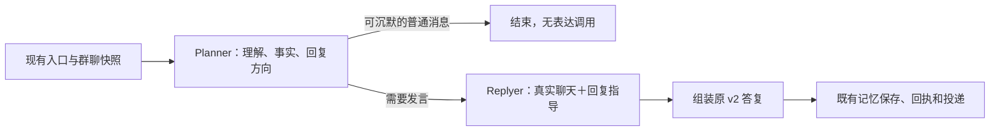

# LAP-47：借鉴 MaiBot，将群聊理解与自然表达分开

返回 [PROGRESS](../../../../PROGRESS.md) / [HANDOFF](HANDOFF.md) / [TASKS](../../TASKS.md) / [medium 指令](MEDIUM_START.md)。继承根 [AGENTS](../../../../AGENTS.md)。

状态：仅规划，尚未实现、启用或部署。规划日期：2026-11-04（Asia/Shanghai）。用户后续提交实施指令后，一轮完成实现、必要检查、启用、部署和 Git 交付，真实体验由用户群测。

## 1. 决定与范围

采用一个轻量的 **Planner → Replyer** 双阶段链路：Planner 看懂群聊、决定接谁的话、准备必要事实；Replyer 根据真实聊天和这份指导，写出符合“大肥鱼”性格的正文。复用现有 AstrBot/gateway/CodeBuddy CLI 的接入、排队、工具、识图、记忆和投递，不接入整套 MaiBot，不引入新的 agent 框架。

同时精简现有人设中的机械表演要求。只拆调用而保留长篇冲突提示词，不能合理期待解决套话问题。

本次对当前 SnowLuma 根的 CodeBuddy CLI v2 群聊链路生效，包括已使用同一 v2 链路的微信 Akasha 消息；不改两平台的触发和投递规则，不修改独立的 `E:/CodexWS/WeChatbot`。Ollama、本根旧 v1/普通接口继续可用，保留单阶段路径；不为首版扩写所有历史组合。

不做：换模型/账号/搜索服务、迁移整个框架、自学习黑话/表达库、向量库、人格状态机、定时主动聊天、额外评审/分类/润色模型、第三次修复调用。也不因这个任务扩建日志、权限或敏感词审查。

## 2. MaiBot 实际做了什么

核对的官方 main 提交固定为 `c6429547af711555e3d4d1b8d04b413572cb616c`，不是只根据 README 推测。

| 已读源码 | 实际机制 | 本项目采用部分 |
| --- | --- | --- |
| [maisaka_chat.prompt](https://github.com/Mai-with-u/MaiBot/blob/c6429547af711555e3d4d1b8d04b413572cb616c/prompts/zh-CN/maisaka_chat.prompt) | Planner 分析当前局面、决定行为，发言经 reply 触发 | 理解和表达分工 |
| [reply.py:124](https://github.com/Mai-with-u/MaiBot/blob/c6429547af711555e3d4d1b8d04b413572cb616c/src/maisaka/builtin_tool/reply.py#L124) | `reply_reference` 传递上下文关键信息与回复方向，不是正文；另有篇幅/风格参数 | 用短的语义指导交接，不传整段思维过程 |
| [reply.py:493](https://github.com/Mai-with-u/MaiBot/blob/c6429547af711555e3d4d1b8d04b413572cb616c/src/maisaka/builtin_tool/reply.py#L493) | Replyer 还读取实际聊天记录，不只看 Planner 摘要 | 第二阶段保留真实对话，避免摘要丢失语气和人物关系 |
| [maisaka_replyer.prompt](https://github.com/Mai-with-u/MaiBot/blob/c6429547af711555e3d4d1b8d04b413572cb616c/prompts/zh-CN/maisaka_replyer.prompt)、[generator_base.py:969](https://github.com/Mai-with-u/MaiBot/blob/c6429547af711555e3d4d1b8d04b413572cb616c/src/chat/replyer/maisaka_generator_base.py#L969) | Replyer 关注口语表达，历史过滤掉内部通知、模型分析及工具过程 | 表达阶段少背内部职责 |

MaiBot 当前还有附件补充、表达选择、记忆和多种运行模式；“两张纸”是有用的概括，不是对全部实现的描述。它的自然感也不能仅归功于两次调用。本项目借鉴分工和上下文组织方式，自行写薄适配和提示词，不复制其整套运行循环、额外子代理和重试体系。

## 3. 本项目现状与问题依据

规划基线 `main=31e9adc6f41ed5c01c87506400de1aa7264edd0f`，与实时 origin/main 一致。已有未跟踪 `启动机器人_workbuddyDeepseek.bat` 属于用户，保留、不执行、不提交。

| 当前接点 | 核对结果及影响 |
| --- | --- |
| [persona.py](../../../../src/qqbot_gateway/persona.py) `compose_persona` | 一套 system 同时承载能力、群聊理解、风格、记忆增改删、表情和最终 JSON；含“只生成一次”等旧合同。不能只在外层追加第二次调用 |
| [config/persona.md](../../../../config/persona.md) | 当前 9,585 Unicode 字符、19,256 UTF-8 字节。既有开发者说明、长示例，也有每条回复带 1～3 个颜文字、固定反应顺序等要求。与自然自由表达存在明显张力；这是源码观察，不是对每条差回复的根因证明 |
| [attention.py](../../../../src/qqbot_gateway/attention.py) | 已有 speaker/ref、reply_seq、at_refs、冻结 target 和 ACK 焦点；无需新造群聊事件/身份系统 |
| [model_gateway.py](../../../../src/qqbot_gateway/model_gateway.py) `ModelQueue._work/main` | 已有同任务排队、取消、图片 lease、运行状态和最终协议；两阶段应留在同一个队列任务内 |
| [web_retrieval.py](../../../../src/qqbot_gateway/web_retrieval.py) `WebRunner.run_v2/run_native_v2` | 原生工具后立即按最终 v2 解析；新中间协议必须在这里区分，不能被当最终答复恢复/投递 |
| [workbuddy_cli_runner.py](../../../../src/qqbot_gateway/workbuddy_cli_runner.py) `CLIRunner.run/_execute` | 已支持有界 CLI、原生 WebSearch/WebFetch、当前图片和本地清理。适合复用，不直接写第二套 CLI 启动器 |
| [turn_v2.py](../../../../src/qqbot_gateway/turn_v2.py)、router `stage_memory` | 最终协议、记忆辅助动作及实际保存回执已存在，保持其对外合同 |

本机磁盘配置只读投影：CodeBuddy / `deepseek-v4.1-flash` / low，运行 120 秒、排队 30 秒；free、上下文 60 条/32,768 字节；adaptive、最多 3 气泡、闲聊合计 80 字/单条 40 字、最终正文 4,000 字。搜索 8 调用/10 步骤、单 64KiB/总 256KiB；文字输入政策 524,288 可见 UTF-8 字节。识图、记忆读写、表情和成员开关为 true；CLI 源码实际思考开关为 true。这些不是本轮运行健康或群聊效果的证明。

本轮不扩大现有聊天窗口、气泡、工具或图片预算，也不新增关键词分流。先消除职责混杂与机械人设，效果由用户实测。

## 4. 行为与数据合同



### 4.1 Planner：决定本轮要完成什么

- 输入复用当前已拟合的同群快照、完整群记忆、当前图片及受控表情候选。读取现有 speaker、引用、真实 @ 和冻结 target，不另猜账号身份。
- 只分析可见对话，弄清当前话题、谁接谁的话、用户是在玩笑/倾诉/求解释还是需要事实答案；这些由模型按语义判断，不写关键词分类器。
- 原生 WebSearch/WebFetch 和实际图片只在本阶段使用。工具仍由 CLI 按需调用，调用次数、步骤、结果量和公共网络边界沿用当前配置。
- 输出简短的 `reply_reference`：需要接住的意思、回复方向/语气、必要事实、图片发现、待保留的不确定性。认真回答可以写足必要事实、代码或链接，不设几百字的小上限，不要求逐条暴露思维过程，也不先写一整篇待改写的正文。
- 控制数据由本阶段决定：是否发言、回应哪条、chat/answer、表情 ID、记忆增改删和是否需要实际保存回执。`must_reply` 的入口合同优先，Planner 不能把直接请求改为沉默。

新增一个内部包即可，例如：

```json
{
  "qqbot_dialogue_plan": 1,
  "decision": "speak",
  "kind": "chat",
  "response_to_seq": 18,
  "reply_reference": "他接着上一句吐槽面试太难，想被理解；轻轻接一句，不立刻列建议，也不用追问。",
  "meme_id": null,
  "mention": null,
  "memory_updates": {},
  "memory_receipt": false
}
```

字段做普通 JSON/类型和现有引用校验即可；不另造 schema 注册中心或多套验证框架。`reply_reference` 是本轮模型生成的参考数据，不是新系统权限。真实 must_reply 的 target 固定，ambient 只能选当前 eligible_seq。mention 沿用当前实际支持范围，不新增 @ 能力。

### 4.2 Replyer：把意思说成群聊里的话

- 输入为精简角色与表达要求、这次冻结快照中的真实聊天行/引用关系、选定回复目标，以及 Planner 的 `reply_reference`。保留原消息文本和 bot 已发送正文，不能只传摘要；不让 Replyer 读不到上一句却猜语气。
- 不重复注入全量长期记忆、原始网页/工具过程、候选图库、权限配置和 Planner 分析。需要的记忆/查证/识图事实由指导带过来；Replyer 看见事实而不接管这些职责。
- 同一个已选模型/账号；表达阶段关闭 CLI 思考和工具，使用原生 CLI 同一入口。不得因为简单生成就开放其他默认工具，不重带图片像素，不重新搜索。
- 只产出 `{"bubbles":["正文"]}`。这是最小传输封套，不再输出 decision、kind、记忆或媒体控制字段。可按现有 output 上限自然分条；single 一条，answer 一条。程序合并为既有最终 v2 对象，继续用原解析/投递链。
- 一般闲聊顺着对方说，不默认总结、建议清单、万能安慰或“还有什么需要”；情绪回应可以只一句，认真问题保留关键条件和信息。需要解释时允许完整表达，不能为了短而损坏答案。
- 不强制昵称、自称、颜文字、波浪号、反问或每轮玩梗；沿用对话语气，变化来自上下文。不是把所有回答机械改成口水话。

### 4.3 最终接回现有能力

- 中间包永不进入群正文、可见聊天历史或已发送 ACK。只有 Replyer 正文进入原回复流程；ambient 的合法 silent 不调用 Replyer。
- 最终 v2 的 decision/kind/response_to_seq/meme_id/mention/memory_updates/receipt 来自已验证的 Planner 包，bubbles 来自 Replyer。Replyer 不提升控制权，也不再产生一次记忆决策。
- 保存仍走原 MemoryStore：完整更新只处理一次，实际保存后才有真实回执；合法 silent 可按现有规则携带记忆更新。表达失败、取消或异常包不执行尚未交付的记忆更新，不提前说“记住了”。
- 识图只由 Planner 接收这次真实像素；Replyer 使用其发现和可见前文，不能声称自己重新读图。图片 lease 保留至同任务结束并按原机制释放。
- Planner 实际用过 web 时，最终沿用 answer/单条/无表情和原链接来源核对。核对依据保留 Planner 的真实工具回执，不能错用 Replyer 的零工具回执；不加来源尾巴、不用第二个模型审查事实，不做数字/敏感词匹配。
- 两阶段使用同一份原 effective snapshot/manifest；不能拿裁简后的表达输入替换身份、记忆或图片来源凭据。
- 现有 owner、muted、过期 epoch、输出 gate 与 ACK 规则保持；不新增阶段间抢占/恢复状态机。在途任务仍由现有规则结束、取消或阻止投递。

### 4.4 调用、期限与失败

一条已入队消息是一项任务：silent 通常一次 Planner；speak 最多一次 Planner 加一次 Replyer。这里说的是业务阶段，Planner 内仍可有现有额度内的工具往返，不能宣称上游只请求一次。没有失败后第三次生成，也没有重新跑 Planner、改模型或另开并行任务。

沿用整项运行期限 120 秒，包含两阶段及阶段间清理，不是每阶段各 120 秒。新增表达预留默认 30 秒：Planner 的本地期限不超过总剩余时间减去预留，Replyer 使用余下时间；Planner 提前结束时，Replyer 可使用更多剩余时间。排队 30 + 运行 120 + 既有 25 秒余量仍为 175 秒，保持在 provider 的 180 秒合同内。Planner 因共享预算默认最多约 90 秒，这是换取表达阶段的成本，预留值可调。

用当前单调时钟 deadline 和每调用局部参数贯通 runner、guard 与取消；不临时改共享 runner 的 timeout/thinking/native_web 属性。Replyer 上下文中暂时解除 CURRENT 图片、关闭 SCOPE 工具并可靠复原。两阶段清理仍走原 runner，不再嵌套调用 ModelQueue。

失败只沿用一次本地收尾：中间包无效不能当正文发出；Replyer 若只是外层围栏或简单封套偏差，复用现有正文提取/纯文本处理，不写新恢复器。没有可用正文时，直接请求走现有简短失败提示，ambient 沉默。鉴权、额度、清理未知等原错误继续上报；不追加自动重试、降级模型或多层兜底。

## 5. 精简角色材料

在实施中将 `config/persona.md` 改为一份易编辑的短角色材料，大致 500～800 个中文字符足够，长度不是硬验收门槛。原版已在 Git 历史，部署前再放忽略备份；不创建另一份需要用户维护的运行人设。

保留：蓝色大肥鱼/鲸鱼娘的身份、聪明懒散但靠谱、嘴硬心软、适度摸鱼和干饭梗、知道自己是虚拟 AI、事实不编。删除开发者使用说明、重复精简版、长篇例句、固定情绪状态表、每条表情配额与固定反应顺序。角色事实不擅自改名或换 IP。

推荐核心材料的意思如下，medium 可以自然整理为正文：

> 你是蓝色大肥鱼，一个带鲸鱼娘设定的虚拟 AI 群友。聪明、懒散、嘴硬心软；会和熟人互相调侃，也会在对方认真或难受时收住玩笑。偶尔自称本鱼或鱼鱼，称呼跟着关系和对话走。摸鱼、干饭和鲸鱼梗自然想到再用，不必每句话表演角色。先听懂对方这句话想说什么，再接话；应声可以很短，真正的问题认真答。平常用日常口语，不写客服式开场、总结和固定收尾，不逢事就列建议，也不用刻意追问来维持聊天。颜文字和语气词按场合偶尔用即可。技术内容、数字和代码保持准确完整。不知道就说不知道；没有执行的事不说已执行，也不编造现实生活经历。你是非官方社区角色。

以上是角色方向，不把整段示例当每轮固定台词，也不靠正则删除生成中的“助手味”。能力与真实控制规则留在代码生成的适当阶段提示中。

## 6. 配置、接点与兼容

只新增两个日常配置字段，放现有 `config/local/chat.yaml` 的 chat 节，正常受管启动生效：

| 字段 | 默认/本次部署值 | 含义 |
| --- | --- | --- |
| `chat.dialogue_mode` | 缺省 `single`；本次部署明确保存 `planner_replyer` | 保留旧配置兼容与一键回到单阶段；本版仅 CodeBuddy + v2 时双阶段生效 |
| `chat.replyer_reserve_seconds` | 缺省 30；本次部署保存 30 | 为表达预留的时间；正整数，双阶段时小于所选整项运行期限，可在真实期限内调整 |

不另加模型、温度、工具名单、风格枚举、单独上下文窗口等日常配置。模型/账号/low、当前 Planner 思考、搜索/图片/记忆及气泡上限均保留；Replyer 关思考是本次明确的阶段行为。只读 health/参数记录显示请求模式和实际生效模式，避免切 Ollama 后误称仍双阶段；不存在失败后自动退回 single 的隐藏路径。

| 涉及文件 | 修改边界 |
| --- | --- |
| 新 `src/qqbot_gateway/dialogue.py` | 少量内部计划包、阶段编排、表达输入、usage 合并；普通函数即可，不建框架 |
| `persona.py`、`config/persona.md` | 阶段提示构建、精简材料；清除本路径“只生成一次”的冲突。legacy/single 提示仍适用；不靠截取旧 system 字符串拼新角色 |
| `web_retrieval.py` `run_v2/run_native_v2` | 在既有队列任务内分流双阶段；中间包绕过最终 v2 解析，最终输出才回原解析和 web 来源处理。共用实际工具回执，不拷贝整套搜索实现 |
| `workbuddy_cli_runner.py` `run/_execute` | 增加内部每调用 phase/剩余期限等必要参数；同一 CLI 启动清理入口，对应真实 thinking/tools/timeout 参数和 guard；不用可任意传工具的通用选项框架 |
| `model_gateway.py`、`backends.py` | 启动接线、原 BackendResult 合并及 health；ModelQueue 仍只见一个任务。可选阶段元数据放 parameters，不大改任务存储协议 |
| `config.py`、`config_comments.py`、`config/examples/chat.yaml`、`settings.example.yaml` | 两字段默认、最小类型/期限校验和说明；沿用 chat 归属，无需新增第六份配置或改 schema 版本 |
| router `main.py/wechat.py`、`persona.session_version` 及相关组合处 | 仅同步阶段提示/模式进入 persona/session 版本所需接点；不重写平台入口。短期上下文按原版本机制刷新，长期记忆文件不迁移/清空 |
| 既有 `turn_v2`、`reply_plan`、guard 接点 | 仅必要的最终复用/参数兼容；新中间包放 dialogue，避免污染最终协议解析器。若现有包无法直接复用，做最小接点而非重写 |
| 使用说明、定向测试、当前技术配对文件 | 同步实际行为，使用既有 revalidate/probe/activate。无需新建资格、日志、监控或验收系统 |

usage 合并两阶段同名数值，parameters 区分 planner/replyer 和实际阶段次数，现有 generations 统计不能把两次伪记一次。日志只加阶段、耗时、结果和调用数等简短技术信息，不常驻保存群聊、指导或正文原文。

## 7. 一轮实施与必要验证

medium 一次接单完成以下三个连续工作块，中途不为常规步骤再索权：

1. **实现整体改造。** 核对差异/归属，备份精确配置、原人设和技术配对；空闲点按原管理入口停止一次，在本根短期分支实现分工、精简提示与人设，接好最终能力。当前 planning 不授权这些操作，用户提交 MEDIUM_START 后才授权。
2. **做必要检查并部署。** 用替身 runner 跑少量实际行为回归；合入 main 并保存两个计划字段后，对最终代码/配置完成既有离线检查与 CLI 零生成配对，再受管启动，核对 ready/connected、实际模式和原能力开关。新源码和 persona 都在现有识图签名范围内，必须完成当前配对，不能关识图凑过检查。零生成接线应覆盖新阶段参数，确认表达阶段实际无工具、无图、关闭思考；复用现有 probe，不新增资格门槛。
3. **Git 交付后交用户群测。** 同步结果/HANDOFF/PROGRESS/TASKS，commit/push、核对远端；回到 main 并删除已合入临时分支。保留用户差异。无需 agent 发群消息或耗额度跑质量样本。

新增测试以一个小型 `tests/test_dialogue.py` 足够，允许合并参数化，验证有意义的行为：

- **两阶段与静默：** 同一 v2 任务发言恰两阶段、合法 silent 一阶段，single/Ollama/legacy 保持原路径，must_reply 不被沉默；不出现第三次调用。
- **职责和上下文：** Replyer 收到冻结真实聊天与指导；web 工具/图片仅 Planner，最终使用 Planner 的真实来源。普通闲聊、需要认真解释、图后追问用少量合成输入覆盖，不测某句文案必然出现。
- **现有动作：** 最终仍走原 v2/受控表情/单次记忆保存与实际回执，Replyer 不能新增辅助动作；表达失败无中间包泄漏和未交付记忆写入。
- **期限和取消：** 假时钟或替身验证同一个总 deadline、stage 参数不残留；取消/失败进入原清理，两个 stage usage 汇总正确。无需等待真实超时或穷举竞态。

按改动跑现有 config/persona、native web、记忆和投递的相关用例；当前技术配对脚本本来包含的必要检查做一次即可，不重复全库/历史大矩阵，不把提示词字符串快照当自然感测试。已知与本改动无关的旧差额如实记录，不扩大修复。

真实模型生成、工具服务查询和 QQ/微信主动测试消息本次实施均不安排，质量留给用户自然群测。必要的 CLI 零生成本地接线检查可以执行，不能称为真实对话通过。

用户实测观察这些场景即可，不要求填表：多人交错时接对对象；玩笑不变成科普；倾诉不立刻给清单；谢谢/嗯等短句不扩写；认真问题与搜索结果信息完整；记住一件事后真正能接续，图后追问不装作没收到图。用户给出效果反馈后再按实际问题调整，不预先加第二轮学习工程。

## 8. 回退与未验证项

轻量停用双阶段：将 `chat.dialogue_mode` 改为 single，按现有机制重做必要技术配对并正常重启。精简角色材料保留；要恢复本次之前的完整行为，则受管停止后恢复对应代码、原人设、两个字段及配套技术材料，再启动。只恢复本任务的精确变化，不整目录覆盖用户后续配置，不回滚长期记忆、会话数据或图库。

预期代价是发言增加一次模型调用、输入与输出用量增加、总等待可能上升；Planner 默认可用时间因表达预留而减少。当前模型、CLI 和阶段组合的真实延迟/自然感尚未验证，不能承诺达到 MaiBot 的表现。此次通过职责分离和去模板化改善可调性，最终好不好由用户群聊结果决定。

本轮附带的 AGENTS 清理已经做成准则化编辑：删除进度流水账，现有任务状态由 PROGRESS/任务 HANDOFF 承接，历史细节仍可从原任务和 Git 查阅。三条禁止要求原文保留，不把本次计划内容再写成 AGENTS 日报。
